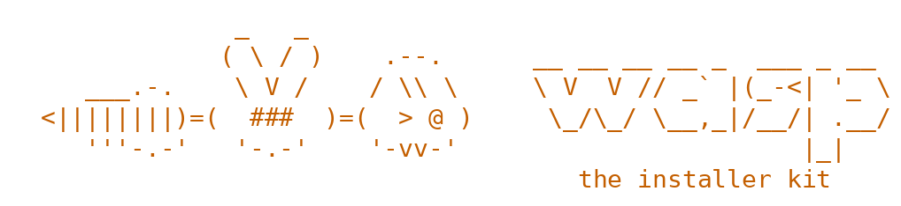

<picture>
  <source media="(prefers-color-scheme: dark)" srcset="assets/banner-dark.png">
  
</picture>

# wasp

The installer kit shared by the Hive and DBee. See SPEC.md.

Phase 1 packages: `profile` (this machine), `gguf` (a model's facts from its
header), `catalog` and `fit` (what can run here, and how well), `fetch`
(verified, resumable downloads), `engine` (the pinned llama.cpp build), and
`cmd/wasp-look` (see what the wizard will offer: `go run ./cmd/wasp-look examples/catalog.json`).
